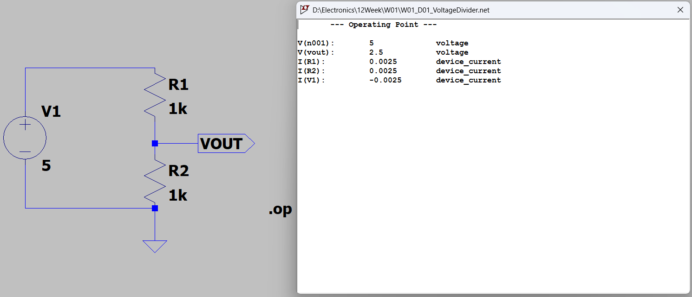
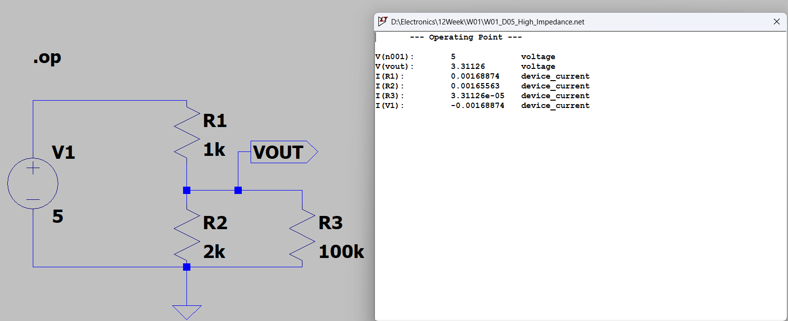
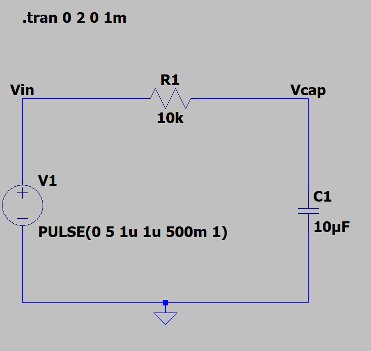
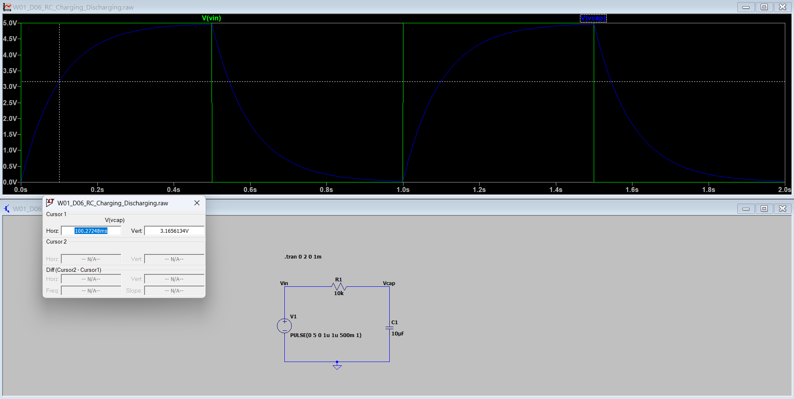
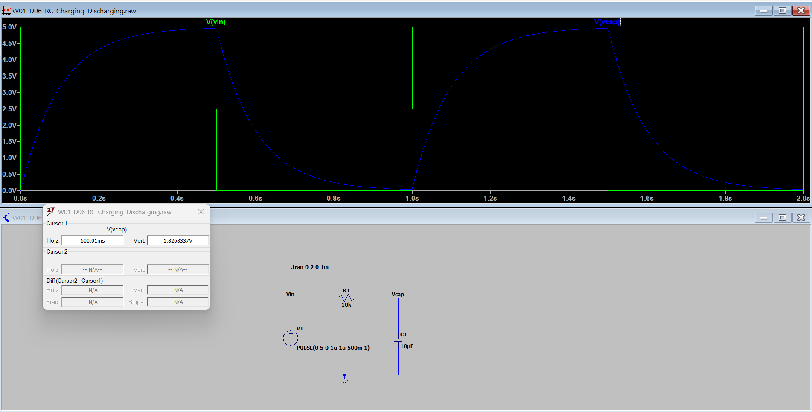

# Week 01 — LTspice Circuit Simulation

## 1. Objective

Learn fundamental circuit analysis using LTspice, including DC voltage division, resistor networks, loading effects, and DC operating point verification.

## 2. Development Environment

| Item | Description |
|---|---|
| Simulation Software | LTspice 26 |
| Analysis Method | DC Operating Point (.op) |
| Input Voltage | 5 V DC |
| Verification | Theoretical Calculation vs. SPICE Simulation |
| Hardware Testing | Not performed |

## 3. Experiment Results

| Experiment | R1 | R2 | R3 (Load) | Simulated VOUT |
|---|---|---|---|---|
| D01 — Basic Voltage Divider | 1kΩ | 1kΩ | None | 2.500 V |
| D02 — Divider Ratio | 1kΩ | 2kΩ | None | 3.333 V |
| D03 — Loading Effect | 1kΩ | 2kΩ | 2kΩ | 2.500 V |
| D04 — Load Comparison | 1kΩ | 2kΩ | 10kΩ | 3.125 V |
| D05 — High-Impedance Load | 1kΩ | 2kΩ | 100kΩ | 3.311 V |

## 4. Circuit Analysis

For an unloaded voltage divider:

VOUT = VIN × R2 / (R1 + R2)

When a load resistor R3 is connected in parallel with R2:

Req = R2 × R3 / (R2 + R3)

VOUT = VIN × Req / (R1 + Req)

The simulation results matched the theoretical calculations within the displayed numerical precision.

## 5. Key Findings

**Voltage Divider Behavior**

The output voltage depends on the resistance ratio between R1 and R2.

**Loading Effect**

Connecting a load resistor in parallel with R2 reduces the equivalent resistance and changes the output voltage.

**Load Impedance**

With R1 = 1kΩ and R2 = 2kΩ, the unloaded output was approximately 3.333 V. A 2kΩ load reduced the output to 2.500 V, while a 100kΩ load resulted in approximately 3.311 V.

**Kirchhoff's Current Law**

The current through R1 equals the sum of the currents through R2 and R3.

## 6. Engineering Relevance

This experiment demonstrates principles applicable to voltage sensing, resistor networks, and the preliminary design of MCU ADC input circuits.

Actual ADC applications additionally require consideration of source impedance, sampling capacitance, acquisition time, and device specifications.

## 7. Verification Status

**Simulation: PASS**

All five experiments produced the expected DC operating point results.

**Physical Hardware: NOT TESTED**

The results are based on ideal resistor models and DC circuit simulation. Component tolerances, noise, temperature effects, and physical measurement errors have not yet been evaluated.

## Simulation Screenshots

### D01 - Basic Voltage Divider

### D03 - Loading Effect

### D05 - High Impedance Load

## W01_D06 — RC Charging & Discharging

### 1. Objective
Verify the charging and discharging characteristics of an RC circuit using LTspice transient analysis.

### 2. Circuit Parameters

| Parameter | Value |
|---|---|
| Input Voltage | 0–5 V |
| Resistance | 10 kΩ |
| Capacitance | 10 µF |
| Time Constant (τ) | 100 ms |
| Simulation Duration | 2 s |
| Input Signal | PULSE(0 5 0 1u 1u 500m 1) |
| Transient Command | .tran 0 2 0 1m |

### 3. Circuit Schematic

### 4. Simulation Waveform

### 5. Measurement Results

The RC time constant is calculated as:

**τ = R × C = 10 kΩ × 10 µF = 100 ms**

| Measurement | Cursor Time | Theoretical Voltage | Simulated Voltage |
|---|---|---|---|
| Charging (1τ) | 100.27248 ms | 3.165608 V | 3.1656134 V |
| Discharging (1τ) | 600.01 ms | 1.826821 V | 1.8268337 V |

*Theoretical values are calculated using the actual cursor timestamps and ideal RC equations.*

**Charging Measurement**

**Discharging Measurement**

### 6. Conclusion

- Verified the exponential charging and discharging behavior of an RC circuit.
- Confirmed the theoretical time constant of 100 ms.
- Observed approximately 63.2% charging and 36.8% remaining voltage after one time constant.
- Demonstrated transient simulation, waveform measurement, and theoretical verification using LTspice.

**Tools:** LTspice, Transient Analysis, Waveform Cursor
