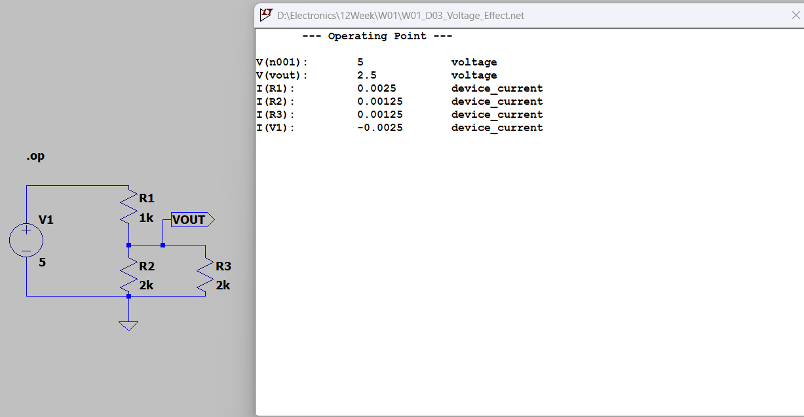
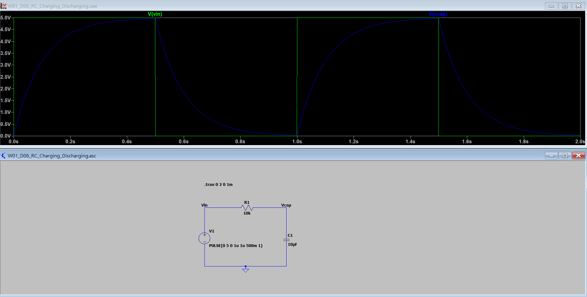
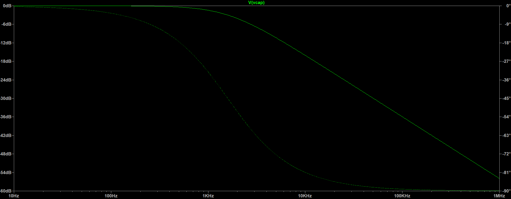
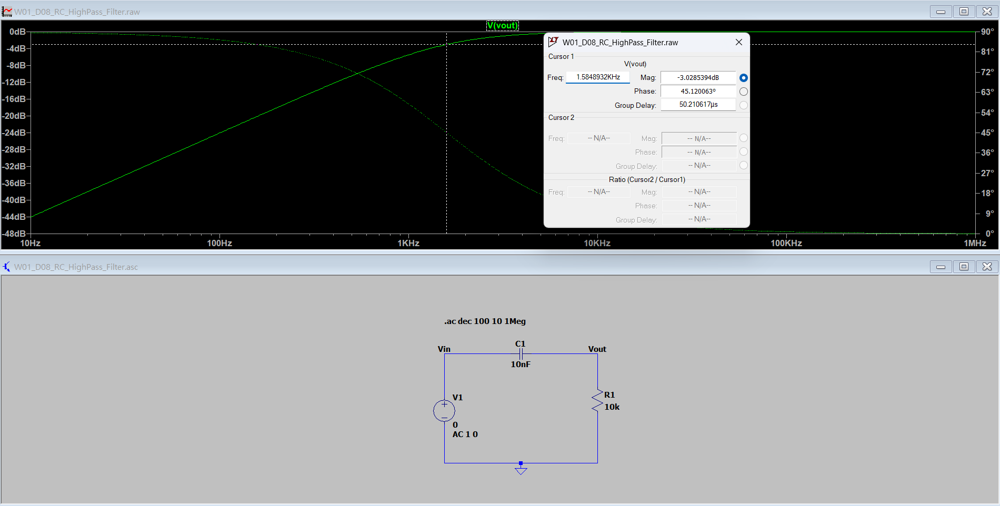
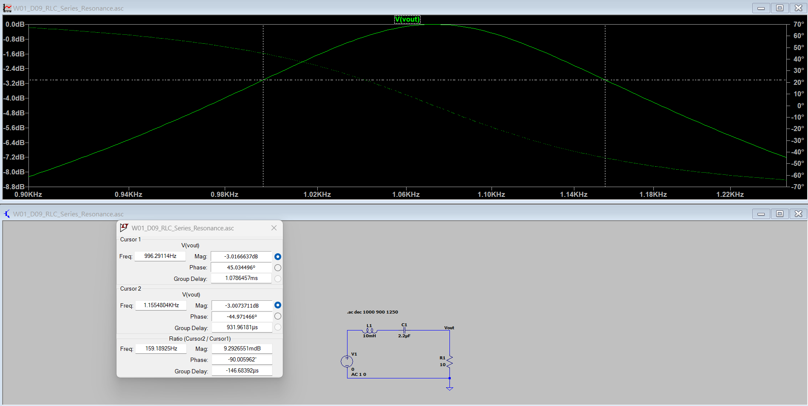

# Week 01 — LTspice Circuit Fundamentals

**Focus:** DC circuit analysis, RC transient response, first-order RC filters, and RLC series resonance.  
**Tools:** LTspice 26 | `.op` DC Operating Point | `.tran` Transient Analysis | `.ac` AC Sweep  
**Verification:** Theoretical calculations compared with LTspice simulations. **Physical hardware testing was not performed.**

## 1. Experiment Index

| ID | Experiment | Main Result | Source |
|---|---|---|---|
| D01 | Basic Voltage Divider | Vout = 2.500 V | [ASC](W01_D01_VoltageDivider.asc) |
| D02 | Voltage Divider Ratio | Vout = 3.333 V | [ASC](W01_D02_Voltage_Ratio.asc) |
| D03 | Loading Effect (2 kΩ load) | Vout = 2.500 V | [ASC](W01_D03_Voltage_Effect.asc) |
| D04 | Load Comparison (10 kΩ load) | Vout = 3.125 V | [ASC](W01_D04_Load_Comparison.asc) |
| D05 | High-Impedance Load (100 kΩ) | Vout = 3.311 V | [ASC](W01_D05_High_Impedance.asc) |
| D06 | RC Charging / Discharging | Time constant: 100 ms | [ASC](W01_D06_RC_Charging_Discharging.asc) |
| D07 | RC Low-Pass Filter | Cutoff: ≈ 1.59 kHz | [ASC](W01_D07_RC_LowPass_Filter.asc) |
| D08 | RC High-Pass Filter | Cutoff: ≈ 1.59 kHz | [ASC](W01_D08_RC_HighPass_Filter.asc) |
| D09 | RLC Series Resonance | Resonance: ≈ 1.073 kHz | [ASC](W01_D09_RLC_Series_Resonance.asc) |

*D01–D05 used a 5 V DC source. For D01–D05, the values above are LTspice DC simulation outputs.*

## 2. Selected Results

### DC Voltage Divider and Loading (D01–D05)

An unloaded divider follows `Vout = Vin × R2 / (R1 + R2)`. With load resistance `R3` connected across `R2`, replace `R2` by `Req = R2 || R3`. A lower load impedance reduces Vout; a 100 kΩ load leaves the output close to the unloaded 3.333 V.

### RC Transient Response (D06)

`R = 10 kΩ`, `C = 10 µF`; theoretical time constant `τ = RC = 100 ms`. Source: `PULSE(0 5 0 1u 1u 500m 1)`; transient analysis: `.tran 0 2 0 1m`.

| Measurement | Cursor Time | Ideal RC Calculation | LTspice |
|---|---:|---:|---:|
| Charging | 100.27248 ms | 3.165608 V | 3.1656134 V |
| Discharging | 600.01 ms | 1.826821 V | 1.8268337 V |

*The discharge calculation accounts for the capacitor voltage reached before the falling edge; it does not assume an exactly 5 V initial capacitor voltage.*

### RC Frequency Response (D07–D08)

Both filters use `R = 10 kΩ`, `C = 10 nF`, and AC input amplitude `1 V`. The theoretical cutoff frequency is `fc = 1 / (2πRC) = 1591.5494 Hz`.

| Measurement | D07: Low-Pass | D08: High-Pass |
|---|---:|---:|
| Cursor Frequency | 1593.4839 Hz | 1584.8932 Hz |
| Cursor Gain | −3.0158 dB | −3.0285394 dB |
| Cursor Phase | −45.0348° | +45.120063° |
| Expected Response | Pass low frequencies | Pass high frequencies |

*The exact theoretical half-power response is −3.0103 dB. Small cursor discrepancies reflect the selected sweep frequencies / cursor placement, not measured component tolerances.*

### RLC Series Resonance (D09)

`L = 10 mH`, `C = 2.2 µF`, `R = 10 Ω`, with AC input amplitude `1 V`; output was measured across `R`.

| Parameter | Theoretical | LTspice / Cursor |
|---|---:|---:|
| Resonance `f0 = 1/(2π√LC)` | 1073.022 Hz | ≈ 1.073 kHz (peak observed) |
| Lower half-power frequency `f1` | 996.392 Hz | 996.291 Hz |
| Upper half-power frequency `f2` | 1155.547 Hz | 1155.480 Hz |
| Bandwidth `BW = f2 − f1` | 159.155 Hz | 159.189 Hz |
| Quality factor `Q = f0/BW` | 6.742 | ≈ 6.741 (using theoretical f0) |

*Cursor gains were approximately −3.0167 dB and −3.0074 dB, close to the −3.0103 dB half-power target. The narrow-band cursor measurements are not an independently measured exact resonance peak.*

## 3. Engineering Takeaways and Limits

- Verified DC voltage division and the effect of load impedance on a resistor network.
- Compared ideal RC time-domain behavior with transient waveforms and cursor measurements.
- Compared low-pass and high-pass magnitude/phase responses around their −3 dB cutoff points.
- Verified RLC resonance, bandwidth, and quality factor using AC Sweep and dual cursors.
- **Scope:** simulation with ideal components only; no bench measurements, component tolerance study, noise analysis, temperature sweep, or ADC input-circuit validation.

## 4. Reproduce the Simulations

1. Open any linked `.asc` file in LTspice.
2. Run the analysis command included in that schematic (`.op`, `.tran`, or `.ac`).
3. Inspect node voltages and use waveform cursors to compare with the reported values.

Raw simulation data (`.raw`) and autogenerated logs (`.log`) are intentionally omitted from this portfolio.
