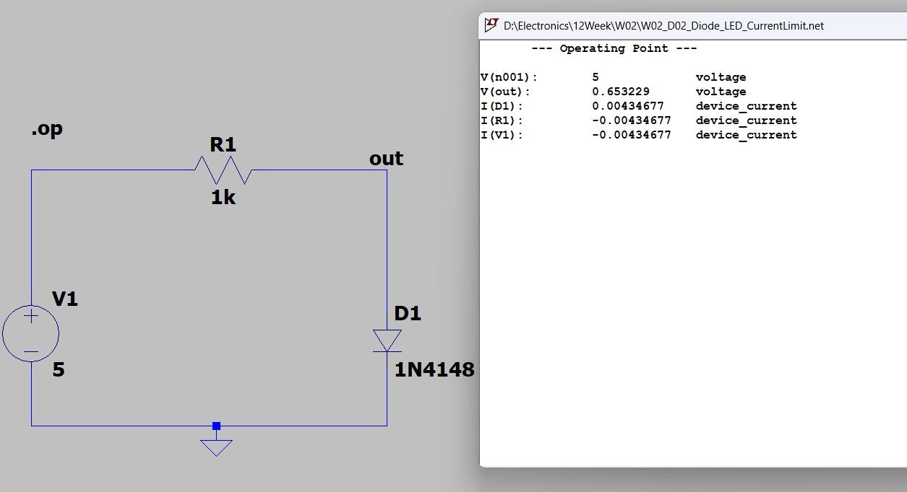
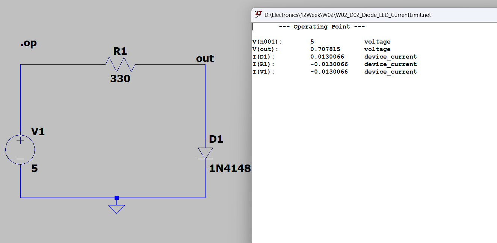
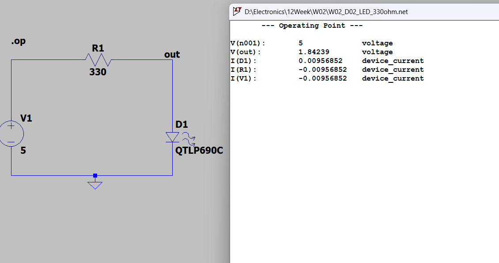
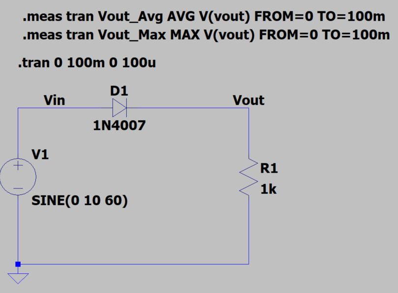
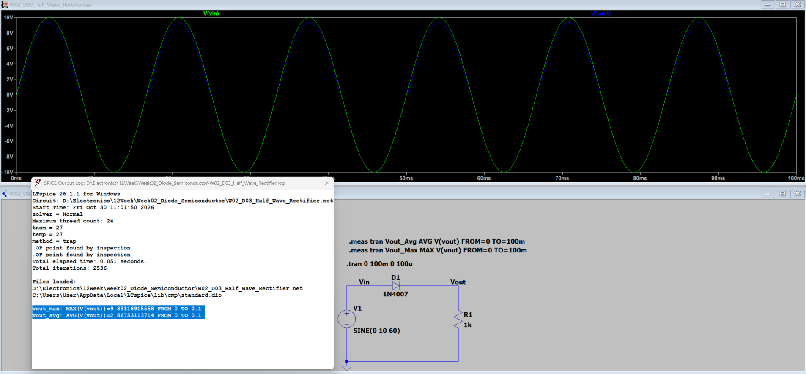
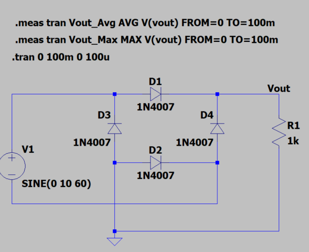
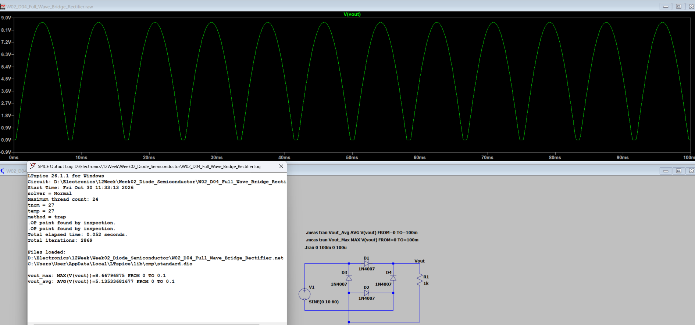

## W02_D01 — Diode I–V Characteristics

**Objective:** Analyze the forward and reverse bias characteristics of a 1N4148 diode using LTspice DC Sweep.

### Circuit Configuration
- Diode: 1N4148
- Resistor: 1kΩ
- DC Sweep: −2V to 5V, step 0.01V

### Simulation Results
| Parameter | Value |
|---|---:|
| Forward Voltage (Vf) | 0.59934 V |
| Forward Current (If) | 1.37361 mA |

### Conclusion
The simulated diode exhibits nonlinear forward conduction. Its forward current increases rapidly with applied forward voltage, while reverse current remains negligible within the tested voltage range.

## W02_D02 — Diode Forward Voltage & LED Current Limiting

### Objective
Compare the forward voltage and current characteristics of a silicon diode (1N4148) and an LED (QTLP690C) under different current-limiting resistor values.

### Simulation Setup
- Software: LTspice
- Analysis: DC Operating Point (`.op`)
- DC Supply: 5V
- Resistors: 1kΩ and 330Ω
- Components: 1N4148, QTLP690C LED

### Simulation Results

| Component | Resistance | Forward Voltage (Vf) | Forward Current (If) |
|---|---|---|---|
| 1N4148 | 1kΩ | 0.653229 V | 4.34677 mA |
| 1N4148 | 330Ω | 0.707815 V | 13.0066 mA |
| QTLP690C LED | 330Ω | 1.84239 V | 9.56852 mA |

### Simulation Screenshots

**1. 1N4148 with 1kΩ Resistor**

**2. 1N4148 with 330Ω Resistor**

**3. QTLP690C LED with 330Ω Resistor**

### Analysis

1. Reducing the resistor from 1kΩ to 330Ω increased the 1N4148 forward current from 4.35mA to 13.01mA.
2. The forward voltage of the 1N4148 increased from 0.653V to 0.708V.
3. With the same 330Ω resistor, the QTLP690C LED exhibited a higher forward voltage and lower current than the 1N4148.
4. Kirchhoff's Voltage Law (KVL) was verified using the simulated voltage and current values.

### Conclusion

The experiment demonstrates the importance of current-limiting resistors in diode circuits. Different diode types exhibit different forward voltage characteristics, which directly affect circuit current.

All results were obtained through LTspice simulation.

## D03 - Half-Wave Rectifier

### Objective
Simulate a half-wave rectifier using a 1N4007 diode and analyze its output waveform.

### Circuit Parameters
- Input: SINE(0 10 60)
- Diode: 1N4007
- Load: 1 kOhm
- Transient analysis: 100 ms

### Simulation Results
| Parameter | Result |
|---|---|
| Input peak voltage | 10 V |
| Output peak voltage | 9.331189 V |
| Average output voltage | 2.867531 V |
| Estimated diode forward drop at peak | 0.668811 V |

### Circuit

### Waveform and Measurements

### Conclusion
The 1N4007 diode conducts during the positive half-cycle and blocks the negative half-cycle. The output is a pulsating DC waveform with a lower peak voltage due to the diode's forward voltage drop.

## D04 - Full-Wave Bridge Rectifier

### Objective
Simulate a full-wave bridge rectifier using four 1N4007 diodes and compare its performance with a half-wave rectifier.

### Circuit Parameters
- Input: SINE(0 10 60)
- Diodes: 4 × 1N4007
- Load Resistance: 1 kOhm
- Transient Analysis: 100 ms

### Simulation Results

| Parameter | Result |
|---|---|
| Input Peak Voltage | 10 V |
| Output Peak Voltage | 8.667969 V |
| Average Output Voltage | 5.135337 V |
| Output Ripple Frequency | 120 Hz |
| Estimated Diode Forward Drop | 0.666016 V per diode |

### Comparison with D03

| Parameter | Half-Wave | Full-Wave |
|---|---|---|
| Peak Voltage | 9.3312 V | 8.6680 V |
| Average Voltage | 2.8675 V | 5.1353 V |
| Ripple Frequency | 60 Hz | 120 Hz |

The full-wave rectifier increased the average output voltage by approximately 79.1% compared with the half-wave rectifier.

### Circuit

### Waveform and Measurements

### Conclusion
The full-wave bridge rectifier converts both positive and negative AC half-cycles into a positive pulsating output.

The average output voltage is higher than that of the half-wave rectifier, while the peak voltage is slightly lower due to two conducting diodes in each current path.

A smoothing capacitor will be investigated in a subsequent experiment.

