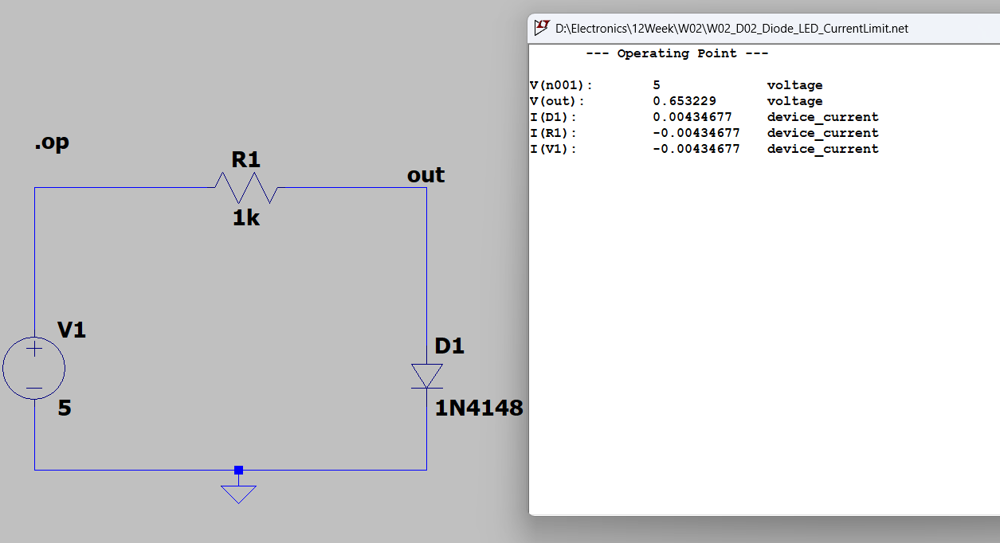
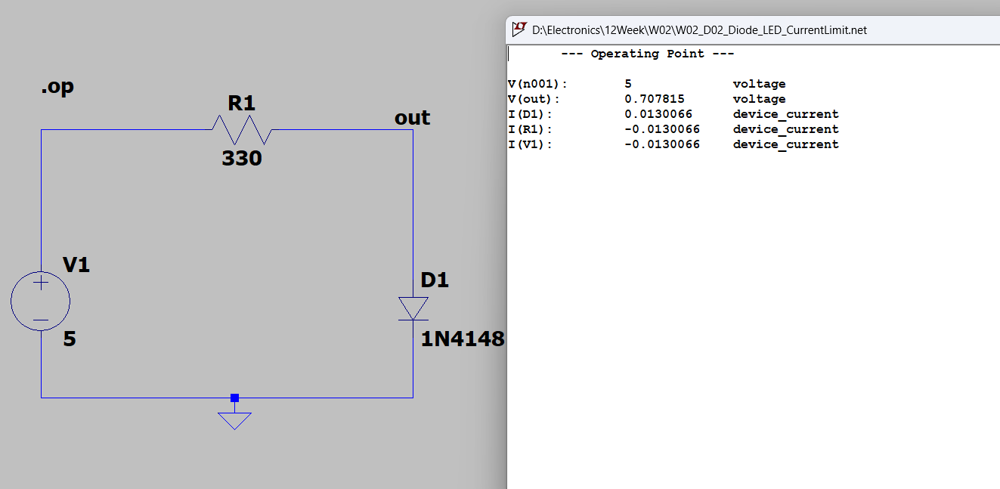
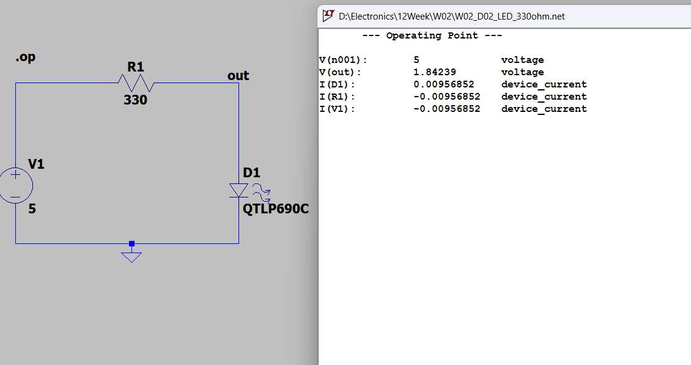

[← 返回 Week02 實驗索引](../README.md)

# W02_D02：二極體順向壓降與 LED 限流

## 1. 實驗目的

比較矽二極體 1N4148 與 QTLP690C LED 在不同限流電阻下的順向電壓與電流，使用 LTspice DC Operating Point（`.op`）進行驗證。

## 2. 模擬設定

| 項目 | 設定 |
|---|---|
| 直流電源 | 5 V |
| 元件 | 1N4148、QTLP690C LED |
| 限流電阻 | 1 kΩ、330 Ω |
| 分析方式 | DC Operating Point（`.op`） |

## 3. 電路與量測結果

**1N4148、1 kΩ**

**1N4148、330 Ω**

**QTLP690C LED、330 Ω**

| 元件 | 電阻 | 順向電壓 Vf | 順向電流 If |
|---|---:|---:|---:|
| 1N4148 | 1 kΩ | 0.653229 V | 4.34677 mA |
| 1N4148 | 330 Ω | 0.707815 V | 13.0066 mA |
| QTLP690C LED | 330 Ω | 1.84239 V | 9.56852 mA |

## 4. 結果分析

1N4148 的限流電阻由 1 kΩ 降至 330 Ω 時，順向電流由約 4.35 mA 上升至 13.01 mA，順向壓降也由約 0.653 V 上升至 0.708 V。在相同 330 Ω 下，LED 順向壓降較高，電流較小，符合串聯限流與 KVL 的基本關係。

## 5. 結論與限制

限流電阻與元件順向壓降共同決定電路電流。以上結果皆來自 LTspice 模擬，未進行實體量測。

## 6. 原始電路

本實驗相關 `.asc` 原始電路放在本資料夾；請依實際上傳檔案名稱補上連結。
