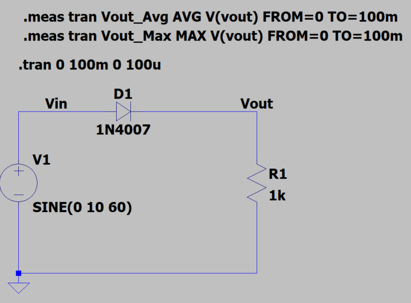
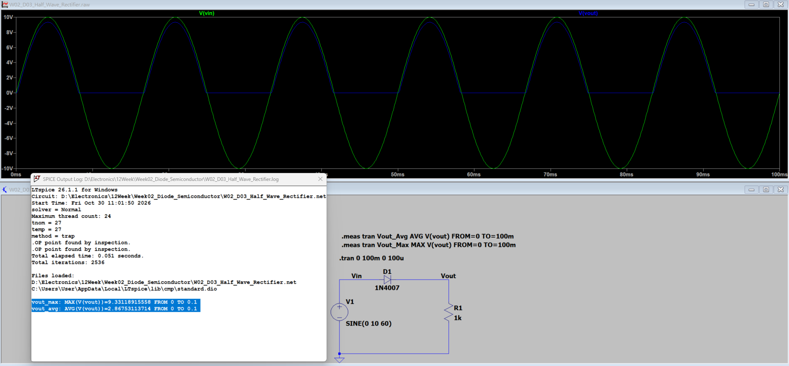

[← 返回 Week02 實驗索引](../README.md)

# W02_D03：半波整流電路

## 1. 實驗目的

使用 LTspice 模擬 1N4007 二極體的半波整流，觀察輸入交流正、負半週與輸出波形的差異。

## 2. 電路與模擬設定

| 項目 | 設定 |
|---|---|
| 輸入訊號 | `SINE(0 10 60)` |
| 二極體 | 1N4007 |
| 負載電阻 | 1 kΩ |
| 暫態模擬時間 | 100 ms |

## 3. 模擬結果

| 項目 | LTspice 結果 |
|---|---:|
| 輸入峰值 | 10 V |
| 輸出峰值 | 9.331189 V |
| 輸出平均值 | 2.867531 V |
| 峰值處二極體順向壓降估算 | 0.668811 V |

## 4. 結論與限制

二極體於正半週導通、負半週截止，形成脈動直流。輸出正峰值因二極體順向壓降而低於輸入峰值。上述數據為模擬結果，尚未進行實體驗證。

## 5. 原始電路

本實驗 `.asc` 原始電路存放於本資料夾；待核對實際檔名後再補上檔案連結。
