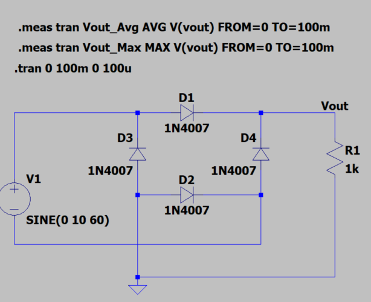
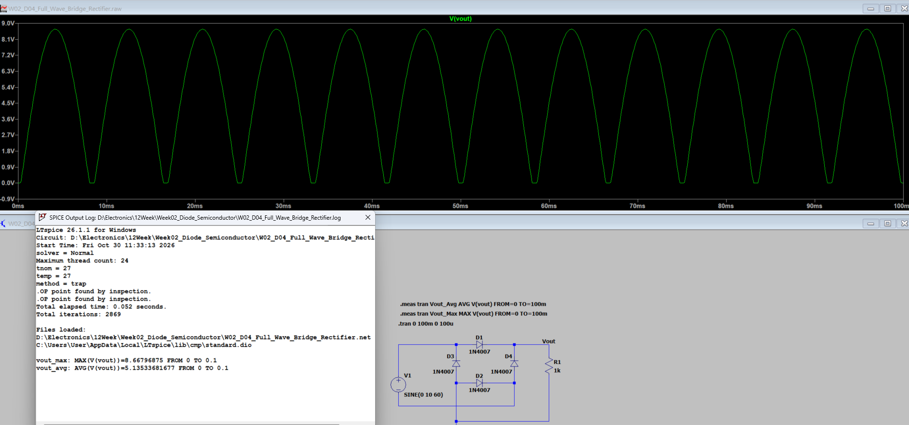

[← 返回 Week02 實驗索引](../README.md)

# W02_D04：全波橋式整流電路

## 1. 實驗目的

使用 LTspice 模擬四顆 1N4007 組成的全波橋式整流電路，並與 D03 半波整流的模擬結果比較。

## 2. 電路與模擬設定

| 項目 | 設定 |
|---|---|
| 輸入訊號 | `SINE(0 10 60)` |
| 整流二極體 | 1N4007 × 4 |
| 負載電阻 | 1 kΩ |
| 暫態模擬時間 | 100 ms |

## 3. 模擬結果

| 項目 | 模擬結果 |
|---|---:|
| 輸入峰值 | 10 V |
| 輸出峰值 | 8.667969 V |
| 輸出平均值 | 5.135337 V |
| 輸出脈動頻率 | 120 Hz |
| 單顆二極體峰值導通壓降估算 | 0.666016 V |

### 與 D03 半波整流比較

| 項目 | D03 半波 | D04 全波 |
|---|---:|---:|
| 輸出峰值 | 9.3312 V | 8.6680 V |
| 輸出平均值 | 2.8675 V | 5.1353 V |
| 輸出脈動頻率 | 60 Hz | 120 Hz |

全波整流利用交流訊號的兩個半週，因此輸出平均值較高；每個導通路徑有兩顆二極體，輸出峰值則較低。上述比較依兩次實驗的 LTspice 模擬結果整理。

## 4. 結論與限制

全波橋式整流使輸出成為 120 Hz 的正向脈動波形。模擬尚未接入濾波電容，因此輸出並非平穩直流；濾波效果於 D05 另行驗證。尚未進行實體量測。

## 5. 原始電路

本實驗 `.asc` 原始電路存放於本資料夾；待核對實際檔名後再補上檔案連結。
