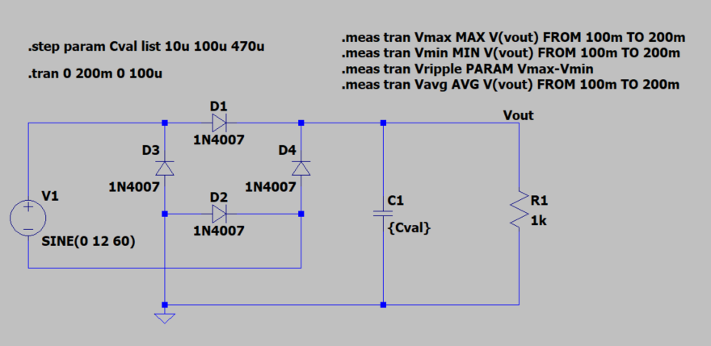
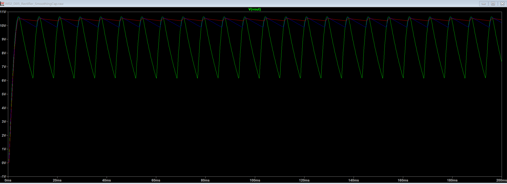
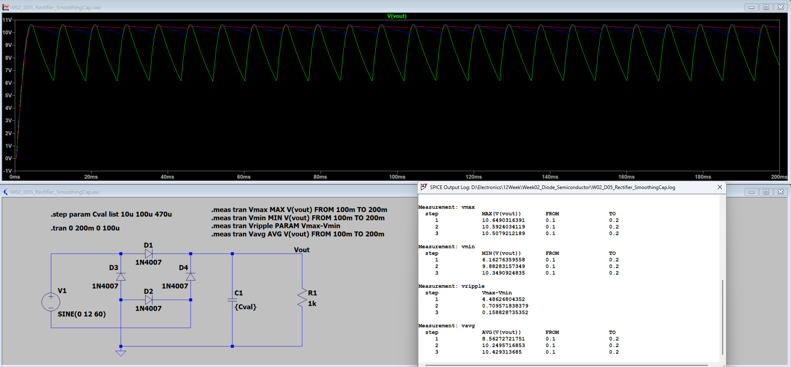

[← 返回 Week02 實驗索引](../README.md)

# W02_D05：全波整流與濾波電容

## 1. 實驗目的

使用 LTspice 比較全波橋式整流電路加裝不同濾波電容後的輸出電壓及漣波（Ripple），了解電容值對直流輸出平滑程度的影響。

## 2. 電路與模擬設定

| 項目 | 設定 |
|---|---|
| 輸入訊號 | `SINE(0 12 60)` |
| 整流二極體 | 1N4007 × 4 |
| 負載電阻 | 1 kΩ |
| 濾波電容 | 10 µF、100 µF、470 µF |
| 暫態模擬時間 | 200 ms |
| 量測區間 | 100–200 ms |

### 電路圖

## 3. 電容掃描及量測結果

| 電容 | Vmax (V) | Vmin (V) | 漣波 Vpp (V) | Vavg (V) |
|---|---:|---:|---:|---:|
| 10 µF | 10.649 | 6.163 | 4.486 | 8.563 |
| 100 µF | 10.592 | 9.883 | 0.710 | 10.250 |
| 470 µF | 10.508 | 10.349 | 0.159 | 10.429 |

漣波峰對峰值：`Vpp = Vmax − Vmin`。

以 10 µF 為比較基準，470 µF 的漣波降低率約為 `(4.486−0.159)/4.486 × 100% ≈ 96.5%`。

## 4. 結論與限制

濾波電容增大可降低整流後的輸出漣波，使負載在整流波峰間得到較穩定的供電。本次結果僅屬 LTspice 模擬；實體設計仍須評估電容耐壓、突入電流、體積及成本。

## 5. 原始電路

本實驗 `.asc` 原始電路存放於本資料夾；待核對實際檔名後再補上檔案連結。
