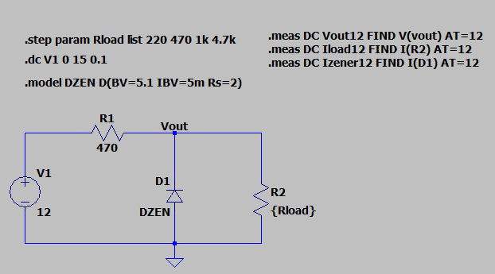
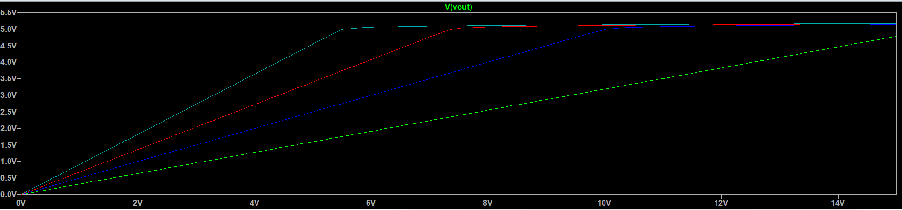
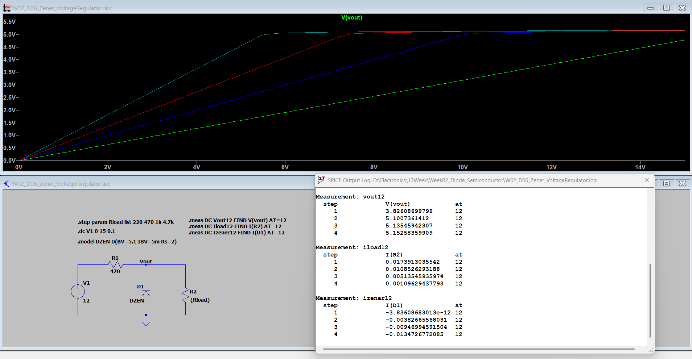

[← 返回 Week02 實驗索引](../README.md)

# W02_D06：齊納二極體穩壓電路（Zener Diode Voltage Regulator）

## 1. 實驗目的

使用 LTspice 模擬齊納二極體穩壓電路，分析不同負載條件下的輸出電壓、齊納電流及功率損耗，了解齊納二極體的穩壓範圍與負載限制。

## 2. 電路設計與模擬設定

| 項目 | 設定 |
|---|---|
| 模擬軟體 | LTspice |
| 輸入電壓 | DC Sweep 0～15 V |
| 串聯電阻 | 470 Ω |
| 齊納二極體模型 | DZEN（BV=5.1、IBV=5m、Rs=2） |
| 負載電阻 | 220 Ω、470 Ω、1 kΩ、4.7 kΩ |
| 量測條件 | Vin = 12 V |

### 電路圖

透過串聯電阻限制電流，並使用反向偏壓的齊納二極體維持輸出電壓。

## 3. 不同負載條件模擬

### 模擬量測結果

| 負載電阻 | Vout (V) | Iload (mA) | Izener (mA) |
|---|---:|---:|---:|
| 220 Ω | 3.826 | 17.391 | ≈ 0 |
| 470 Ω | 5.101 | 10.853 | 3.827 |
| 1 kΩ | 5.135 | 5.135 | 9.470 |
| 4.7 kΩ | 5.153 | 1.096 | 13.473 |

### 結果分析

- **220 Ω：** 負載電流需求過大，齊納二極體無法維持約 5.1 V 的穩壓輸出。
- **470 Ω：** 輸出約為 5.101 V，齊納二極體進入穩壓工作區。
- **1 kΩ、4.7 kΩ：** 負載電流降低，更多電流流經齊納二極體。

因此，負載電阻與可用的齊納電流會直接影響穩壓效果。

## 4. 功率損耗分析

| 負載電阻 | 串聯電阻功率 (mW) | 齊納二極體功率 (mW) |
|---|---:|---:|
| 220 Ω | 142.16 | ≈ 0 |
| 470 Ω | 101.28 | 19.52 |
| 1 kΩ | 100.26 | 48.63 |
| 4.7 kΩ | 99.76 | 69.42 |

功率計算公式：

- 串聯電阻：P = (Vin − Vout)² / R
- 齊納二極體：Pz = Vout × Izener

當負載電阻增加時，負載電流下降，但齊納電流及其功率損耗可能上升。

實際設計時，須確認串聯電阻與齊納二極體的額定功率及散熱條件。

## 5. 實驗結論

本次實驗驗證齊納二極體在不同負載條件下的穩壓行為。

1. 在 Vin = 12 V、負載電阻為 470 Ω～4.7 kΩ 時，輸出電壓約維持在 5.1 V。
2. 當負載降至 220 Ω，齊納二極體無法維持正常穩壓。
3. 負載電阻增加時，齊納電流與功率損耗也可能增加。
4. 設計齊納穩壓電路時，必須同時評估電流分配、負載範圍及元件功率額定值。

**實驗限制：** 以上數據均來自 LTspice 模型模擬，尚未進行實體量測、溫度測試、最大輸入電壓及無負載條件驗證。

## 6. LTspice 原始檔案

本實驗原始 `.asc` 電路檔案存放於此實驗資料夾，可使用 LTspice 開啟並重新執行模擬。

---

[← 返回 Week02 實驗索引](../README.md)
