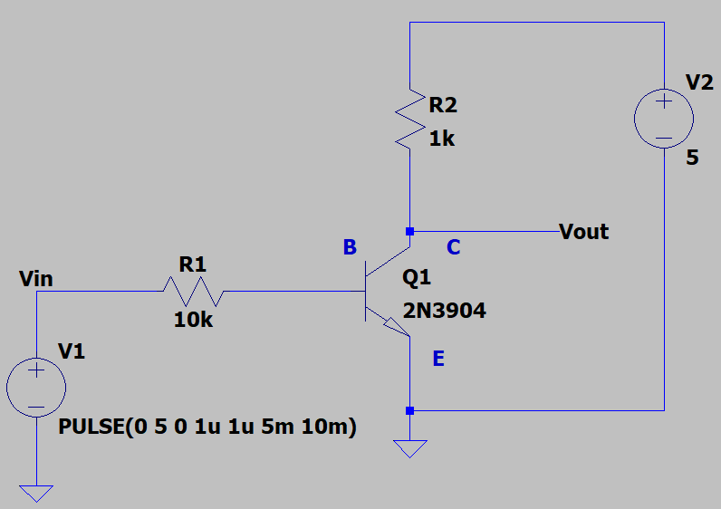
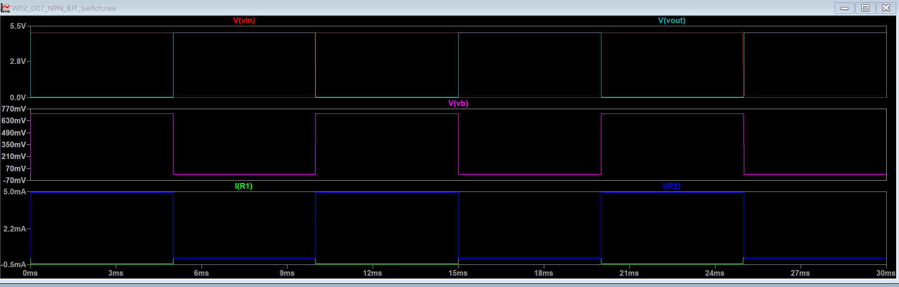
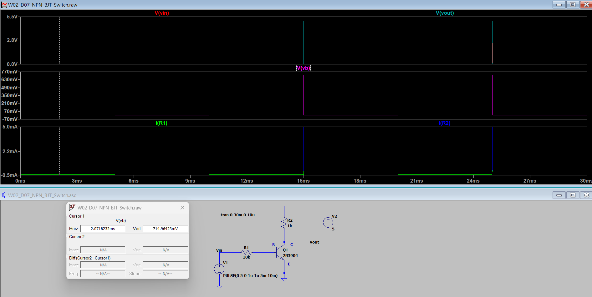
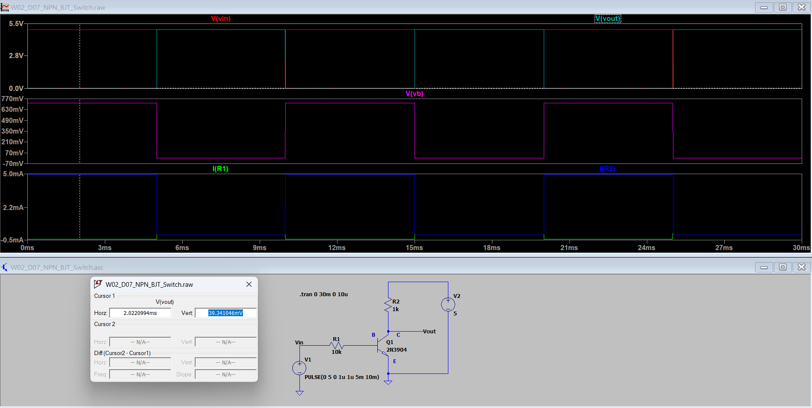
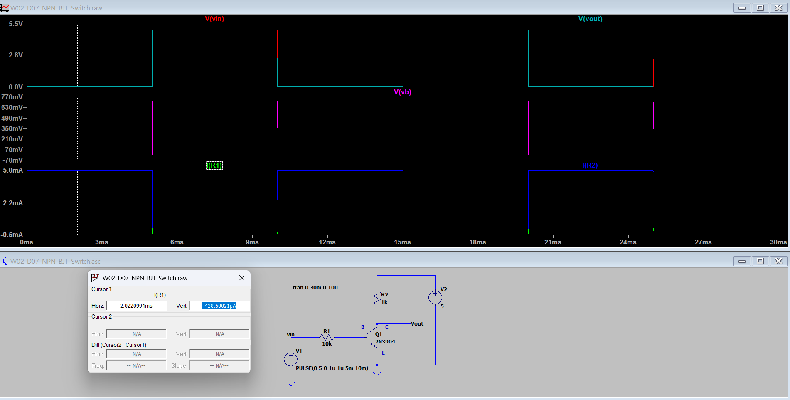

[← 返回 Week02 實驗索引](../README.md)

# W02_D07：NPN BJT 電晶體開關特性

## 1. 實驗目的

使用 LTspice 模擬 2N3904 NPN 電晶體的開關特性，觀察截止區（Cutoff）與飽和區（Saturation）的電壓、電流變化，並透過雙游標量測驗證其反相開關行為。

## 2. 電路設計與模擬設定

| 項目 | 設定 |
|---|---|
| 模擬軟體 | LTspice |
| 電晶體 Q1 | 2N3904 |
| 電源 VCC | DC 5 V |
| 基極電阻 RB | 10 kΩ |
| 集極電阻 RC | 1 kΩ |
| 輸入訊號 | `PULSE(0 5 0 1u 1u 5m 10m)` |
| 暫態分析 | `.tran 0 30m 0 10u` |

### 電路圖

電路採用 NPN 電晶體低側開關架構（Low-Side Switch），由基極輸入脈波控制集極電流，並由集極端觀察輸出電壓。

## 3. 暫態模擬（Transient Analysis）

### 開關狀態比較

| 輸入 Vin | 電晶體狀態 | 集極輸出 Vout |
|---|---|---|
| 0 V | 截止（OFF） | 接近 5 V |
| 5 V | 飽和導通（ON） | 接近 0 V |

由模擬波形可觀察到，輸入高電位時，集極輸出為低電位；輸入低電位時，集極輸出回到高電位，呈現反相開關特性。

## 4. 雙游標量測結果

### 4.1 基極－射極電壓（VBE）

### 4.2 集極－射極電壓（VCE）

### 4.3 基極電流（IB）

### 量測數據彙整

| 量測項目 | LTspice 結果 |
|---|---:|
| VBE（ON） | 0.714964 V |
| VCE（ON） | 0.039341 V |
| IB（ON，電流大小） | 0.42850 mA |
| IC（ON） | 4.96067 mA |
| IC（OFF） | 約 0 A |

量測數據取自暫態波形的穩態區間。

### 4.4 補充電流量測

[查看 IB 與 IC 雙游標補充截圖](images/W02_D07_Cursor_Measurements_IR1&IR2.png)

**注意：** 此補充圖的兩個游標分別對應不同電流波形，其差值不能當作同一電流的 ON／OFF 變化量。

## 5. 強迫電流增益分析

BJT 在飽和開關條件下，可計算強迫電流增益（Forced Current Gain）：

\[
\beta_{forced}=\frac{|I_C|}{|I_B|}
\]

代入模擬數據：

\[
\beta_{forced}=\frac{4.9606693}{0.42850124}\approx11.58
\]

此數值是飽和開關條件下的集極與基極電流比例，不能直接視為電晶體在順向主動區的直流電流增益 hFE。

## 6. 實驗結論

本次透過 LTspice 成功驗證 2N3904 NPN 電晶體的截止與飽和開關特性。

主要成果：

1. 確認輸入高電位時，電晶體進入飽和區，VCE 約為 39.34 mV。
2. 確認輸入低電位時，電晶體進入截止區，集極電流接近零。
3. 觀察輸入與集極輸出之間的反相關係。
4. 透過雙游標量測基極、集極電壓與電流，計算強迫電流增益約 11.58。

**實驗限制：** 上述結果均來自 LTspice 模擬，尚未經實體電路量測。實際性能可能受到電晶體個體差異、溫度與開關時間等因素影響。

## 7. LTspice 原始電路

[W02_D07_NPN_BJT_Switch.asc](W02_D07_NPN_BJT_Switch.asc)

---

[← 返回 Week02 實驗索引](../README.md)
