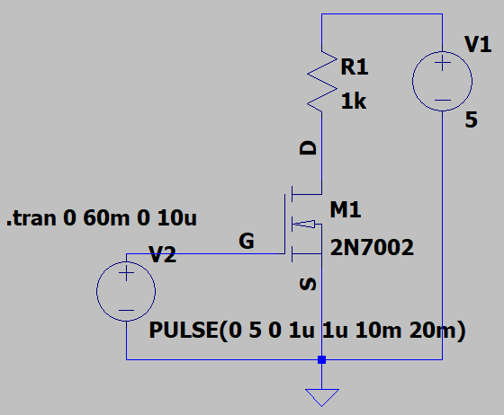
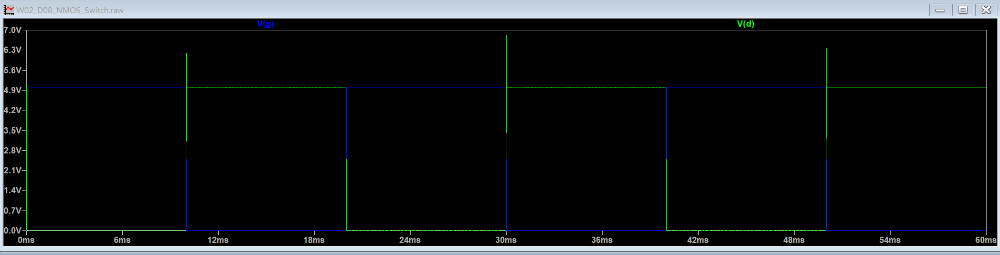
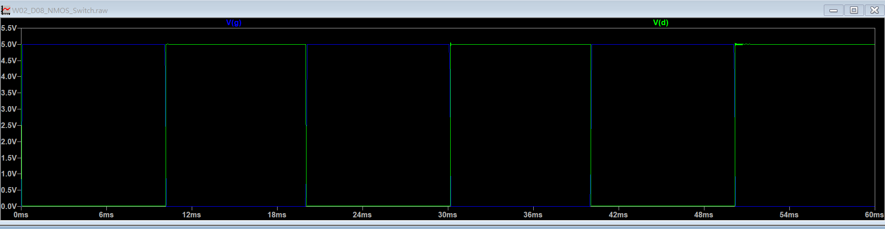
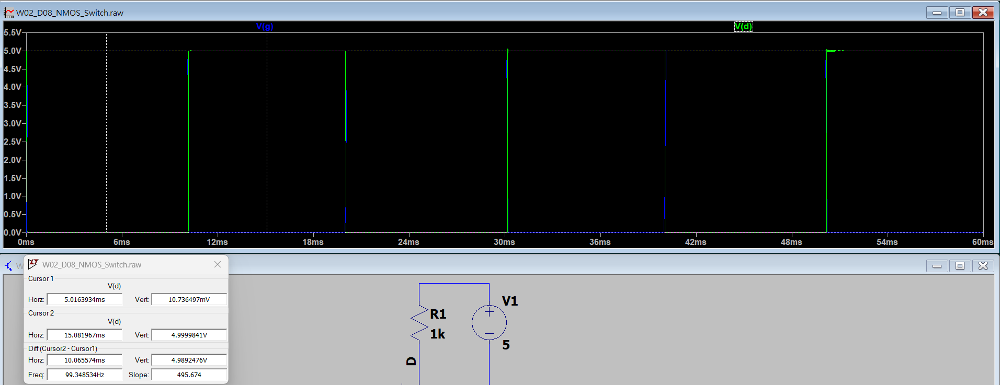
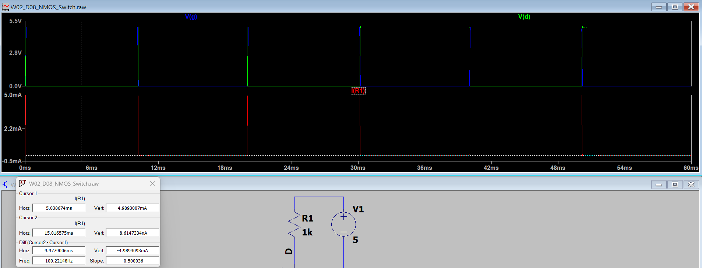

# W02_D08 — NMOS 開關特性與 BJT 比較

## 1. 實驗目的

利用 LTspice 建立 2N7002 NMOS 低側開關電路，驗證閘極電壓對導通、截止及汲極電流的影響，並與 W02_D07 NPN BJT 開關進行比較。

## 2. 電路與模擬設定

| 項目 | 設定 |
|---|---|
| MOSFET | 2N7002 |
| 電源 VCC | 5V DC |
| 負載電阻 R1 | 1kΩ |
| 閘極控制 | PULSE(0 5 0 1u 1u 10m 20m) |
| 暫態分析 | .tran 0 60m 0 10u |
| 延緩切換測試 | PULSE(0 5 0 100u 100u 10m 20m) |

## 3. 模擬結果

### 3.1 閘極與汲極電壓

- Gate = 5V：NMOS 導通，Drain 電壓接近 0V。
- Gate = 0V：NMOS 截止，Drain 電壓接近 5V。
- 1µs 切換條件下，Drain 出現短暫電壓過衝。
- 將上升與下降時間延長至 100µs 後，觀察到明顯改善。

### 3.2 穩態量測結果（100µs 切換）

| 項目 | 導通 ON | 截止 OFF |
|---|---:|---:|
| V(Gate) | 約 5V | 約 0V |
| V(Drain) | 10.736mV | 4.999984V |
| I(R1) | 4.9893mA | 約 0mA |

## 4. 導通損耗計算

導通時：

- Drain 電流：約 4.9893mA
- Drain-Source 電壓：約 10.736mV
- 等效導通電阻：約 2.15Ω
- 穩態導通損耗：約 53.6µW

以上為特定模擬工作點的估算值，並非元件在所有條件下的規格。

## 5. BJT 與 NMOS 比較

依 D07 與 D08 的既有穩態模擬結果整理：

| 比較項目 | BJT 2N3904 | NMOS 2N7002 |
|---|---:|---:|
| 電源 | 5V | 5V |
| 負載電阻 | 1kΩ | 1kΩ |
| 導通壓降 | 約 39.341mV | 約 10.736mV |
| 負載電流 | 約 4.961mA | 約 4.989mA |
| 元件穩態導通損耗 | 約 195.2µW | 約 53.6µW |
| 控制方式 | 基極電流 | 閘源電壓 |

**比較限制：** 兩個電路的驅動方式及切換設定不完全相同，因此此表僅比較穩態開關特性，不作整體效率或切換速度的優劣結論。

## 6. 實驗結論

1. 成功建立 2N7002 NMOS 低側開關，驗證 Gate 控制與 Drain 電壓的反向變化。
2. 透過雙游標量測確認導通及截止狀態，並利用負載電流計算等效導通電阻與損耗。
3. 發現在快速切換條件下，Drain 可能出現電壓過衝；延長切換時間後，過衝明顯減少。
4. 在本次穩態模擬條件下，NMOS 的導通壓降與元件導通損耗低於 BJT。
5. 後續可針對 Gate 驅動電阻、寄生電容與時間步長進行更完整的瞬態驗證。

**驗證限制：** 本實驗屬 LTspice 模擬，尚未進行實體電路量測；過衝原因及完整切換損耗尚待確認。
