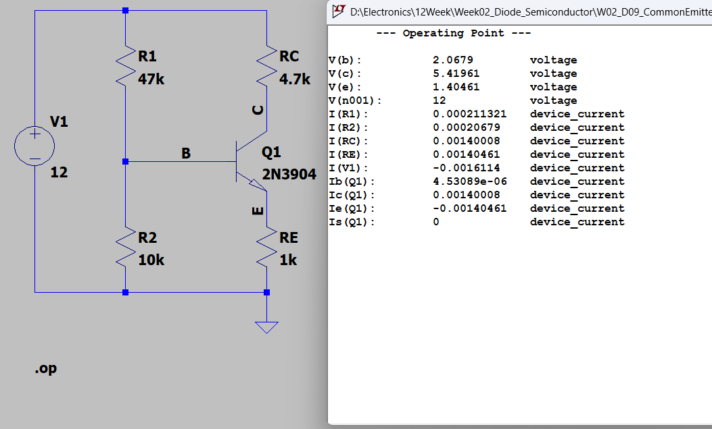
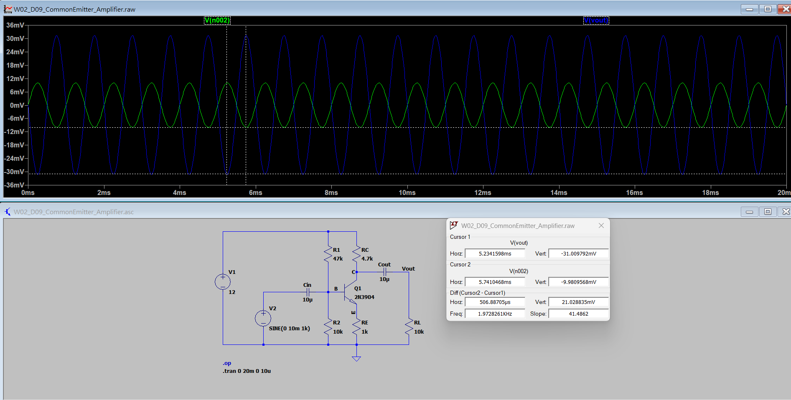
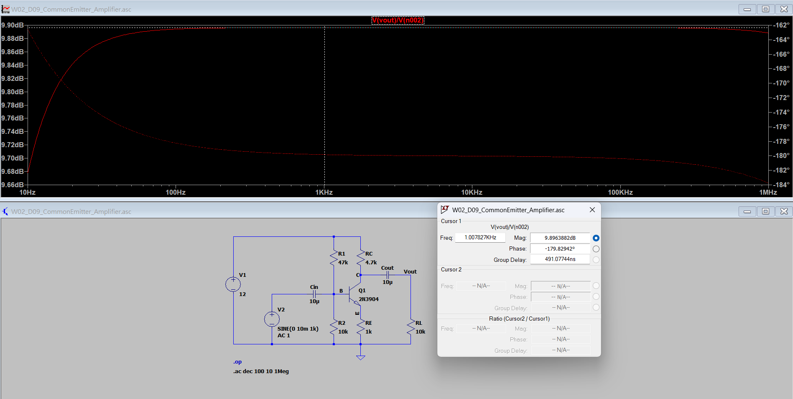
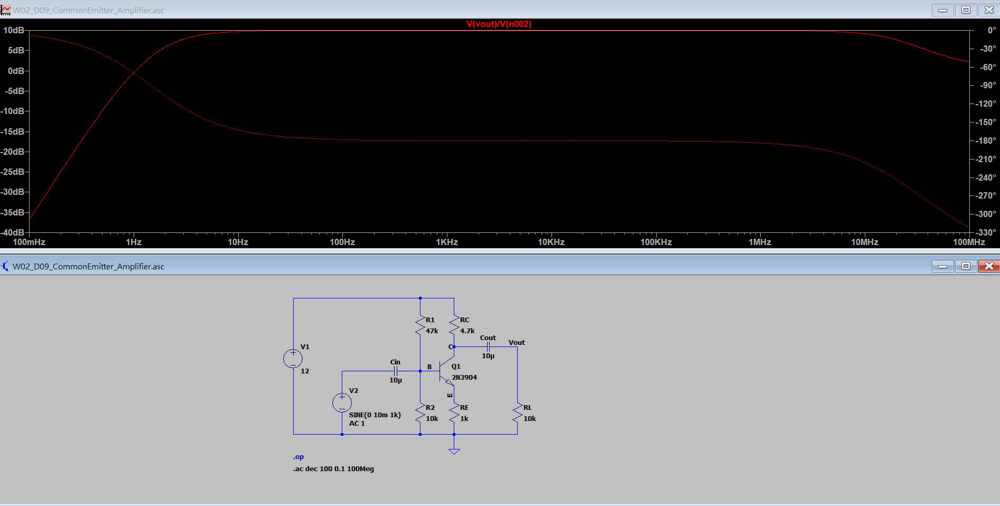
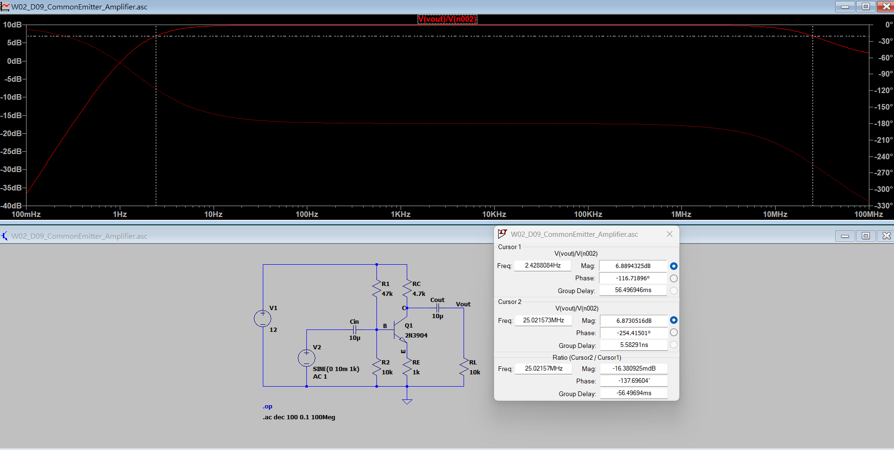

# W02_D09：NPN BJT 共射極放大器（Common-Emitter Amplifier）

## 1. 實驗目的

使用 LTspice 建立 2N3904 NPN 電晶體共射極放大器，透過分壓偏壓電路設定靜態工作點（Q-Point），並觀察交流訊號放大、180° 相位反轉及頻率響應特性。

**本次驗證項目：**
- DC Operating Point：確認電晶體工作於順向主動區
- Transient Analysis：量測輸入與輸出波形
- Voltage Gain：計算電壓增益
- AC Analysis：觀察 Bode Plot 與相位
- Bandwidth：量測低頻、高頻 −3 dB 截止頻率

## 2. 電路設計與元件參數

| 元件 | 數值 | 功能 |
|---|---|---|
| V1 | 12 V | 直流供電 |
| V2 | SINE(0 10m 1k)、AC 1 | 交流訊號源 |
| Q1 | 2N3904 | NPN 電晶體 |
| R1 | 47 kΩ | 基極上拉偏壓 |
| R2 | 10 kΩ | 基極下拉偏壓 |
| RC | 4.7 kΩ | 集極電阻 |
| RE | 1 kΩ | 射極電阻 |
| RL | 10 kΩ | 輸出負載 |
| Cin | 10 µF | 輸入耦合電容 |
| Cout | 10 µF | 輸出耦合電容 |

電路透過 R1、R2 提供基極偏壓，搭配 RE 穩定工作點，使電晶體於主動區進行小訊號放大。

## 3. DC Operating Point（靜態工作點）



### 模擬結果

| 量測項目 | LTspice 結果 |
|---|---:|
| 基極電壓 VB | 2.06790 V |
| 集極電壓 VC | 5.41961 V |
| 射極電壓 VE | 1.40461 V |
| 集極電流 IC | 1.40008 mA |
| 基極電流 IB | 4.53089 µA |

**工作點計算：**

- VBE = VB − VE = 0.66329 V
- VCE = VC − VE = 4.015 V
- 直流電流增益 βDC = IC / IB ≈ 309

由於 VBE 為順向偏壓，且 VC > VB > VE，判定 2N3904 工作於順向主動區（Forward-Active Region）。

## 4. Transient Analysis（暫態分析）



### 模擬設定

```spice
.tran 0 20m 0 10u
```

輸入訊號：

```text
SINE(0 10m 1k)
```

### 波形觀察

| 項目 | 量測結果 |
|---|---:|
| 輸入振幅 Vin | 約 10 mV |
| 輸出振幅 Vout | 約 31 mV |
| 輸入頻率 | 1 kHz |
| 電壓增益 Av | 約 −3.107 V/V |
| 相位關係 | 約 180° 反相 |

輸出振幅約為輸入的 3.1 倍。由於共射極放大器從集極取出訊號，因此輸出電壓與輸入電壓呈現反相特性。

電壓增益：

**Av ≈ −31.01 mV / 9.981 mV ≈ −3.107 V/V**

此為根據暫態波形峰值大小估算的結果。

## 5. AC Analysis（交流頻率響應）

### 5.1 1 kHz 增益與相位



模擬設定：

```spice
.ac dec 100 10 1Meg
```

| 量測項目 | LTspice 結果 |
|---|---:|
| 頻率 | 1.007827 kHz |
| 電壓增益 | 9.8963882 dB |
| 相位差 | −179.82942° |
| 增益倍率 | 約 3.125 倍 |

增益換算：

**|Av| = 10^(9.8963882/20) ≈ 3.125**

由於相位接近 −180°，因此可將此頻率下的電壓增益近似表示為 −3.125 V/V。

### 5.2 完整 Bode Plot



擴大頻率掃描範圍：

```spice
.ac dec 100 0.1 100Meg
```

觀察結果：

- 低頻區：受到輸入與輸出耦合電容影響，增益下降。
- 中頻區：增益約維持在 9.9 dB。
- 高頻區：受到電晶體模型中的寄生電容及高頻特性影響，增益逐漸衰減。

## 6. −3 dB 截止頻率與頻寬



以中頻增益約 9.896 dB 為基準：

**−3 dB 截止門檻 ≈ 6.886 dB**

### 雙游標量測

| 量測項目 | 低頻截止點 | 高頻截止點 |
|---|---:|---:|
| 頻率 | 2.4288084 Hz | 25.021573 MHz |
| 電壓增益 | 6.8894325 dB | 6.8730516 dB |

頻寬：

**BW = fH − fL ≈ 25.02157 MHz**

以上為 LTspice 雙游標近似量測結果，兩個游標未完全落在精確的 −3.0103 dB 截止門檻。

## 7. 實驗結論

本次完成 2N3904 共射極放大器的 DC 偏壓、暫態分析及 AC 頻率響應驗證。

**主要成果：**

1. 確認電晶體工作於順向主動區，VCE 約 4.015 V。
2. 1 kHz 輸入訊號可獲得約 3.1 倍的電壓放大。
3. 輸出與輸入相位差約為 180°。
4. 透過 Bode Plot 觀察低頻、中頻與高頻響應。
5. 取得約 2.43 Hz～25.02 MHz 的 −3 dB 通帶範圍。

**限制與後續驗證：**

上述結果均為 LTspice 模擬數據，尚未進行實體電路量測。實際電路仍會受到元件公差、PCB 寄生效應、訊號源阻抗及量測設備負載影響。

## 8. LTspice 原始檔案

[W02_D09_CommonEmitter_Amplifier.asc](W02_D09_CommonEmitter_Amplifier.asc)

本實驗使用 LTspice 完成電路設計與模擬，並另以 KiCad 進行 PCB 設計練習。
